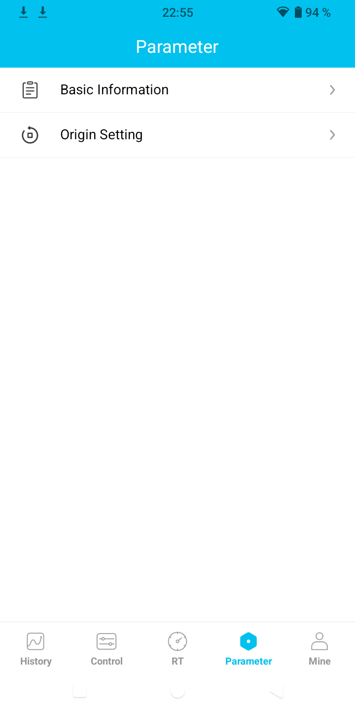
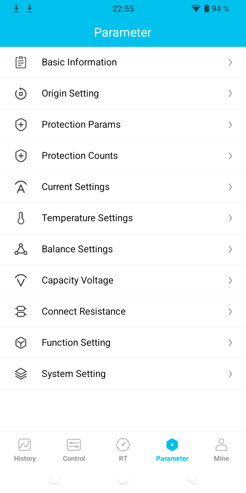

[Русский](#русский) | [English](#english)

## Русский

В новых версиях XiaoXiang Electric из Google Play во вкладке **Parameter** производитель оставил только информацию и базовые настройки. Остальные параметры батареи пропали из интерфейса, и приходится искать старые моды. В некоторых из них перепутаны регистры EEPROM — с настройками батареи так экспериментировать не хочется.

Я сделал небольшой модуль для LSPosed: он открывает все 11 разделов Parameter прямо в оригинальном приложении из Google Play. Сам APK приложения и его подпись модуль не меняет.

### Что открывается

Protection Params, Protection Counts, Current Settings, Temperature Settings, Balance Settings, Capacity Voltage, Connect Resistance, Function Setting, System Setting и остальные разделы — всего 11 пунктов.

### Что нужно

- Android с root-доступом (Magisk или KernelSU)
- LSPosed
- XiaoXiang Electric из Google Play (`com.jiabaida.little_elephant`)
- Вход в аккаунт приложения: достаточно обычной регистрации по email. Одобрение от JBD и дилерские права не нужны.

### Установка

1. Установите XiaoXiang Electric из Play Market и войдите в аккаунт.
2. Установите APK модуля из [Releases](../../releases).
3. Включите модуль в LSPosed и отметьте XiaoXiang Electric в списке приложений.
4. Перезапустите приложение.

### Скриншоты

| Было | Стало |
|---|---|
|  |  |

Скриншоты добавлю сюда позже.

### Как это работает

Модуль хукает `ParamsFragment.initDataList(boolean)`: передаёт `true` вместо исходного аргумента и выставляет `BleUtils.rootPswCheckStatus = true` и `BleUtils.blePswStatus = 10006`. Эти значения нужны приложению, чтобы показать полный список параметров.

### Сборка

```sh
./gradlew assembleDebug
```

### Осторожно

Крутите пороги токов и напряжений с умом. За состояние батареи отвечаете вы.

## English

In newer XiaoXiang Electric releases from Google Play, the manufacturer left only information and basic settings in the **Parameter** tab. The rest of the battery settings disappeared from the interface, so people end up looking for old mods. Some of those mix up EEPROM registers, which is not something I want to risk with battery settings.

I made a small LSPosed module that opens all 11 Parameter sections in the original Google Play app. It does not modify the app APK or its signature.

### What it unlocks

Protection Params, Protection Counts, Current Settings, Temperature Settings, Balance Settings, Capacity Voltage, Connect Resistance, Function Setting, System Setting, and the remaining sections — 11 items in total.

### Requirements

- Android with root access (Magisk or KernelSU)
- LSPosed
- XiaoXiang Electric from Google Play (`com.jiabaida.little_elephant`)
- Sign in to the app: a regular email registration is enough. You do not need JBD approval or dealer privileges.

### Installation

1. Install XiaoXiang Electric from Google Play and sign in.
2. Install the module APK from [Releases](../../releases).
3. Enable the module in LSPosed and select XiaoXiang Electric in the app list.
4. Restart the app.

### Screenshots

| Before | After |
|---|---|
|  |  |

### How it works

The module hooks `ParamsFragment.initDataList(boolean)`, passes `true` in place of the original argument, and sets `BleUtils.rootPswCheckStatus = true` and `BleUtils.blePswStatus = 10006`. The app uses these values to show the full parameter list.

### Build

```sh
./gradlew assembleDebug
```

### Be careful

Set current and voltage limits with care. You are responsible for your battery.
